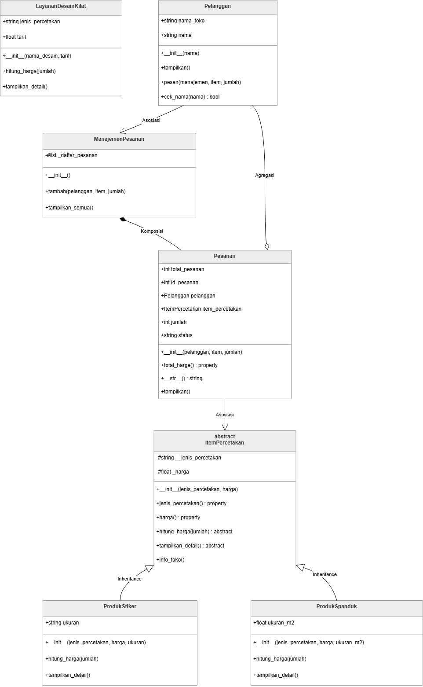

**Nama:** Rega Wahyu Firenza  
**NIM:** 2509106085  

---

## 1. Deskripsi Singkat Program
Program Judul **Stickyfy** berfungsi untuk mengelola sistem pemesanan pada usaha percetakan digital. Pada posttest modul ini, program dikembangkan dengan menerapkan **Abstraksi (Abstract Base Class)**, **Polimorfisme (lewat pewarisan & duck typing)**, **Operator Overloading (`__str__`)**, serta bonus penerapan prinsip **SOLID (Open-Closed Principle)**.

---

## 2. Struktur Class & Penjelasan Kode

Program ini terdiri dari beberapa class utama yang saling terintegrasi:

### 1. Class `ItemPercetakan` (Abstract Base Class / Abstraksi)
* **Peran:** Sebagai kerangka utama untuk semua jenis produk/layanan percetakan.
* **Atribut & Enkapsulasi:** Menyimpan `__jenis_percetakan` (private) dan `harga` (menggunakan property setter dengan validasi angka > 0).
* **Abstract Method:** Memiliki dua method wajib (`hitung_harga` dan `tampilkan_detail`) yang menggunakan decorator `@abstractmethod`. Kelas ini **tidak dapat diinstansiasi secara langsung** (jika dipaksa akan memunculkan `TypeError`).
* **Method Konkret:** `info_toko()` sebagai fungsi biasa yang bisa langsung dipakai bersama oleh semua subclass.

### 2. Class `ProdukStiker` & `ProdukSpanduk` (Inheritance & Polimorfisme)
* **Peran:** Subclass turunan dari `ItemPercetakan`.
* **Implementasi:** Keduanya wajib meng-override *abstract method* dari induknya. Masing-masing subclass memiliki rumus perhitungan harga dan tampilan detail yang berbeda (`ProdukStiker` menghitung per pcs, sedangkan `ProdukSpanduk` menghitung berdasarkan ukuran meter persegi / $m^2$).

### 3. Class `LayananDesainKilat` (Duck Typing)
* **Peran:** Kelas mandiri yang tidak memiliki hubungan pewarisan (*inheritance*) sama sekali dengan `ItemPercetakan`.
* **Implementasi:** Memiliki nama method yang persis sama (`hitung_harga` dan `tampilkan_detail`), sehingga bisa diproses secara fleksibel berdampingan dengan produk lain tanpa membuat program error.

### 4. Class `Pelanggan` & `Pesanan` (Asosiasi, Agregasi, & Operator Overloading)
* **Pelanggan:** Mengelola data pembeli dan memiliki method `pesan()` untuk mencatat transaksi ke dalam manajemen.
* **Pesanan:** Menggabungkan data pelanggan dan produk/layanan. Menerapkan **Operator Overloading (`__str__`)** agar objek pesanan dapat langsung dicetak rapi menggunakan fungsi `print()` secara otomatis.

### 5. Class `ManajemenPesanan` (Komposisi)
* **Peran:** Mengelola daftar pesanan yang masuk.
* **Komposisi:** Objek pesanan dibuat dan disimpan langsung di dalam list internal manajemen, sehingga siklus hidupnya bergantung pada objek manajemen ini.

---

## 3. Penjelasan Relasi UML pada Program



1. **Inheritance (Pewarisan):** 
   * `ProdukStiker` dan `ProdukSpanduk` mewarisi `ItemPercetakan` (digambarkan dengan garis panah segitiga kosong).
2. **Asosiasi (`Pelanggan` -> `ManajemenPesanan` / `ItemPercetakan`):** 
   * `Pelanggan` menggunakan objek manajemen dan item percetakan lewat parameter method, hidup secara mandiri tanpa kepemilikan mutlak.
3. **Agregasi (`Pesanan` o-> `Pelanggan`):** 
   * `Pesanan` menampung objek `Pelanggan`. Jika pesanan dihapus, data pelanggan aslinya tetap aman di memori.
4. **Komposisi (`ManajemenPesanan` *-> `Pesanan`):** 
   * Objek `Pesanan` dibentuk di dalam manajemen. Jika manajer pesanan dihapus, seluruh daftar pesanan di dalamnya ikut musnah.

---

## 4. Screenshot Output Program & Bukti Abstraksi

Berikut adalah hasil eksekusi program beserta bukti penanganan error saat mencoba menginstansiasi *Abstract Class* secara langsung:

```text
=================================================================
     DEMONSTRASI PROGRAM STICKYFY - OPERATOR OVERLOADING __str__     
=================================================================

[1. BUKTI ABSTRAKSI & PENGUJIAN INSTANSIASI ABSTRACT BASE CLASS]
[GAGAL DIINSTANSIASI SESUAI TEORI] Terdeteksi TypeError:
 -> Can't instantiate abstract class ItemPercetakan without an implementation for abstract methods 'hitung_harga', 'tampilkan_detail'

[2. INISIALISASI OBJEK SUBCLASS & PENGGUNAAN METHOD KONKRET BERSAMA]
[INFO] Layanan resmi dari toko percetakan Stickyfy.
Produk Stiker : Stiker Vinyl Glossy | Ukuran: A6 | Harga: Rp2500/pcs
Produk Spanduk: Spanduk Outdoor | Ukuran: 2 m2 | Harga: Rp25000/m2

[3. POLIMORFISME VIA PEWARISAN (Satu Loop untuk Subclass Berbeda)]
Produk Stiker : Stiker Vinyl Glossy | Ukuran: A6 | Harga: Rp2500/pcs
Produk Spanduk: Spanduk Outdoor | Ukuran: 2 m2 | Harga: Rp25000/m2

[4. DEMONSTRASI DUCK TYPING (Kelas Luar Tanpa Hubungan Pewarisan)]
Memproses item ber-interface duck typing...
Produk Stiker : Stiker Vinyl Glossy | Ukuran: A6 | Harga: Rp2500/pcs
-> Total Biaya untuk 10 layanan: Rp25000
Memproses item ber-interface duck typing...
Jasa Desain   : Desain Maskot Vector | Tarif Tetap: Rp50000
-> Total Biaya untuk 2 layanan: Rp100000

[5. MANAJEMEN PESANAN, KOMPOSISI, & OPERATOR OVERLOADING (__str__)]
[OK] Pesanan #1 berhasil dicatat.
[OK] Pesanan #2 berhasil dicatat.

Menampilkan Daftar Pesanan dengan Overloaded `__str__`:
Pesanan ID: #1 | Pelanggan: Rega | Produk: Stiker Vinyl Glossy | Total Harga: Rp50000
--------------------------------------------------
Pesanan ID: #2 | Pelanggan: Wahyu | Produk: Desain Maskot Vector | Total Harga: Rp100000
--------------------------------------------------
